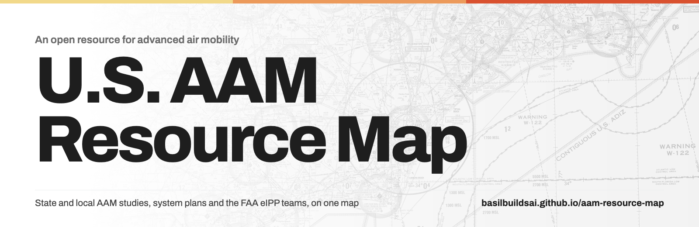
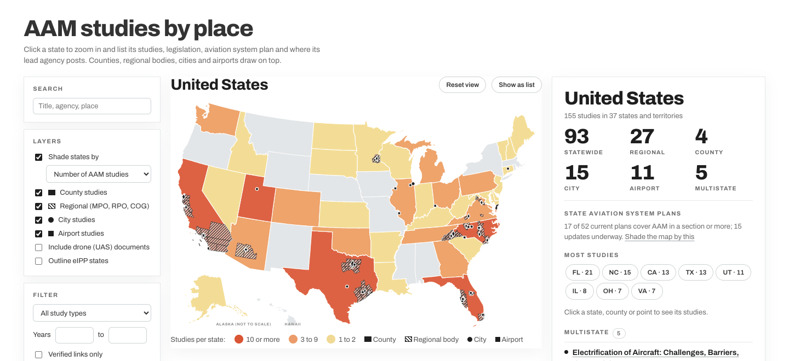
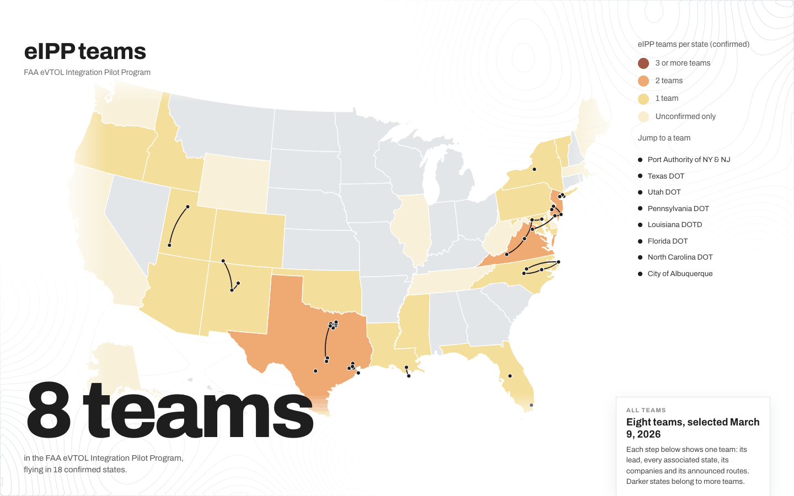
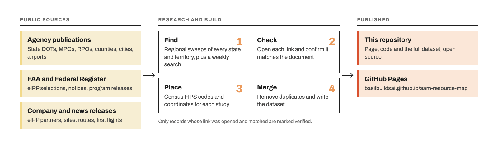

An open resource that gathers the advanced air mobility (AAM) studies published by states and local governments, and tracks the teams in the FAA eVTOL Integration Pilot Program (eIPP).

**[Open the live map →](https://basilbuildsai.github.io/aam-resource-map/)**

Air taxis, electric regional aircraft and drone delivery are moving from test flights to planning. Most of that planning happens at the state and local level: state DOTs, MPOs and regional councils, counties, cities and airports. Their studies are scattered across hundreds of agency websites. This map puts them in one place, by geography, with a link to each publisher's own copy.

Everything here is open source. This repository holds the page, its code and the full compiled dataset. Last updated 2026-10-29.

## What it shows

- **AAM studies by place.** 163 studies across 37 states, at every level: 99 statewide, 27 regional (MPO, RPO, COG, TPO), 4 county, 16 city, 12 airport and 5 multistate. 154 link to a source document, and 152 of those links were opened and checked. States are shaded by how many studies they have. County studies fill their county, regional bodies hatch their member counties, and city and airport studies are points.
- **A state page for every state.** Click a state to zoom in and see its studies grouped by level, its AAM lead office, task force or council, AAM legislation, its state aviation system plan and how much of it covers AAM, and where the lead agency posts about AAM (websites, LinkedIn, X and Instagram).
- **State aviation system plans.** Every state plus Puerto Rico and DC checked. 17 current plans cover AAM in a section or more, and 15 updates are underway. Each plan is rated by AAM content, from none to a standalone AAM element. The map can be shaded by this instead of study count.
- **The eIPP teams, one at a time.** A scrolling map that starts with all 8 teams, flying in 18 confirmed states, and then steps through each one: the lead agency and its logo, every associated state, the partners the FAA listed when it selected the team, named sites, announced routes and first flights. A details section lists the other partners named by the team, the companies or the press, milestones and where sources disagree.
- **Drone (UAS) documents** (30) as an optional layer, kept separate from AAM studies.
- **A list view** of every study, and search and filters by type, year and verified links.

Alaska and Hawaii are insets. Territories are listed under the map.

## How it works

A record is marked **verified** only when its link was opened and matched the document. Records found in the literature without a working link say "link not checked". eIPP states that come from a single unconfirmed source are marked "unconfirmed" and are not counted in the confirmed totals.

## Files

| Path | What it is |
|---|---|
| `index.html` | The whole page: layout, styles and map code (D3 and TopoJSON from cdnjs) |
| `data/studies.json` | Every study, plus each state's profile: AAM lead, legislation, system plan and agency links |
| `data/eipp.json` | The eIPP program and its eight teams: states, partners, sites, routes, milestones and sources |
| `geo/counties-albers-10m.json` | U.S. state and county boundaries from the U.S. Census Bureau via [us-atlas](https://github.com/topojson/us-atlas) |
| `logos/` | Logos of the eight eIPP team leads (shown in black above each team's name) and, in `logos/partners/`, of the partner companies the FAA listed for each team (shown under the team details map). From Wikimedia Commons, each organization's website or its LinkedIn page; each logo belongs to its owner |
| `readme/` | The images in this README, drawn in the same style as the page |
| `vfr.jpg` | Title background: a grayscale crop of the FAA Charlotte VFR sectional chart (public domain) |

To run it locally, serve the folder with any static web server, for example `python3 -m http.server`, and open `http://localhost:8000`.

## Help improve it

Missing a study, or found a broken link? [Open an issue](https://github.com/basilbuildsai/aam-resource-map/issues) with the title, the publisher and a link, or message me on [LinkedIn](https://www.linkedin.com/in/basil-yap-461b1975/).

## License

- **Code** (`index.html`): MIT License, see `LICENSE`.
- **Data and written content** (`data/`): Creative Commons Attribution 4.0 (CC BY 4.0), see `LICENSE-DATA.txt`. Credit as Basil Yap, U.S. AAM Resource Map, https://basilbuildsai.github.io/aam-resource-map/.

The studies themselves belong to their publishers. This map links to them and does not host them.

## Built by

Basil Yap. I've spent 17 years helping drones and advanced air mobility aircraft into the national airspace. Other open projects include the [AAM Fleet Registry](https://basilbuildsai.github.io/aam-fleet-registry/) and the [DFR Adoption Map](https://basilbuildsai.github.io/dfr-program-map/).
